<div align="center">



# Antigravity Client

**Multi-account Android client for Google Antigravity Remote — powered by Mozilla GeckoView for isolated profiles, native in-app Google Sign-In, and mobile-first ergonomics.**

<p>
  
  
  
  
  
</p>

Built by **[Trần Hoàng Khánh Minh (`dev-hkm`)](https://khanhminh.tech/)** — *Turning Ideas Into Products.*

</div>

---

## Why Antigravity Client?

Running Google Antigravity Remote inside a regular mobile browser or a standard Android WebView breaks quickly:

1. **Multi-account juggling**: Switching between personal, work, or team Google accounts in a single browser mixes cookies and forces constant sign-outs.
2. **WebView OAuth walls**: Google blocks `accounts.google.com` sign-in inside Android `WebView` (`X-Requested-With`), and bouncing out to an external Custom Tab cannot pass session cookies back into an embedded container.
3. **Desktop-assumed UI on phones**: Split-view sidebars crush down to an unreadable strip on narrow viewports, and hover-based Radix/Base UI submenus (like Model Effort and Context Window pickers) select the parent row on first touch before you can even pick an option.

**Antigravity Client** solves all three by embedding a standalone Firefox engine (**GeckoView 157**), isolating every account inside its own `contextId` container, and bundling a built-in WebExtension tailored for mobile screens.

---

## Key Features

### Standalone GeckoView Browser Engine
- **In-App Google Sign-In**: Runs on Mozilla's standalone Gecko engine rather than Android System `WebView` — zero `X-Requested-With` injection, permissive cross-origin cookie behavior for Google auth relays, and `ActivityDelegate` support for FIDO/passkey prompts.
- **Single-Surface Popup Stack**: `window.open` OAuth flows swap cleanly onto the active `GeckoView` with an inline back/close bar and shared account `contextId`, avoiding multi-`SurfaceView` deadlocks when multitasking.
- **Settled IME Resizing**: Uses `WindowInsets.imeAnimationTarget` (Android 11+) so the viewport resizes once cleanly when opening or dismissing the keyboard without per-frame surface thrashing.

### True Multi-Account Isolation
- **Container Partitions (`account_<id>`)**: Each profile maintains completely isolated cookies, localStorage, and site data via `GeckoSessionSettings.Builder().contextId(...)`.
- **Color-Coded Profiles & Custom Endpoints**: Create, rename, color-tag, switch, or wipe individual account containers (defaulting to `https://antigravity.google.com`).

### Mobile WebExtension Ergonomics (`antigravity_ext`)
- **Responsive Drawer Fix**: Converts `[data-testid="sidebar-split"]` on viewports `< 768px` into a clean slide-over drawer (`min(82vw, 280px)`) while letting the conversation pane take 100% width, with tap-outside dismissal.
- **Touch Effort & Context Picker Bridge**: Intercepts touch clicks on Base UI/Radix submenu rows (`model-selector-effort-group`, `model-selector-context-window-submenu`) and dispatches directional keyboard events so submenus expand cleanly on mobile without premature selection.
- **Live Theme & Desktop Toggle**: Syncs web theme (`bcsp`, `body.dark-theme`, `.theme-standalone`, `preferredColorScheme`) via native extension messaging, toggles Mobile/Desktop UA + viewport modes, and optionally auto-clicks Connect.

### Customizable Floating Pill & Material 3 Shell
- **Draggable Floating Pill**: Snap-to-edge action pill with customizable orientation (Horizontal / Vertical), scale (Compact / Standard / Large), opacity, and per-button visibility toggles.
- **Full-Height Sheets**: Material 3 Accounts and Settings bottom sheets (`skipPartiallyExpanded = true`) with Dynamic Color (Material You) support on Android 12+.

---

## Project Structure

```text
app/src/main/
├── assets/antigravity_ext/     # Built-in GeckoView WebExtension (CSS + document_start + effort picker)
├── java/com/hkm/antigravity/
│   ├── MainActivity.kt         # Edge-to-edge activity & repository wiring
│   ├── browser/                # GeckoRuntimeHolder (singleton runtime, ETP/cookie config, extension loader)
│   ├── data/                   # Account & Settings models + DataStore / Gson repositories
│   └── ui/
│       ├── components/         # GeckoBrowserContainer, DraggableActionPill, BottomSheets, Dialogs
│       ├── screens/            # MainScreen
│       └── theme/              # Material 3 theming & Lucide-style icons
desktop/                        # Legacy Electron desktop companion prototype
tools/                          # Automated Playwright fixture test for EffortPickerBridge
```

---

## Tech Stack

- **UI**: Jetpack Compose, Material 3 (Compose BOM `2026.02.01`), Edge-to-Edge WindowInsets
- **Browser Engine**: Mozilla GeckoView (`org.mozilla.geckoview:geckoview-omni-arm64-v8a:157.0.20261005135250`)
- **Language & Build**: Kotlin `2.4.20`, Android Gradle Plugin `9.2.1`, Min SDK 26 / Target SDK 36
- **Persistence**: Jetpack DataStore Preferences & Gson

---

## Building from Source

1. Clone the repository:
   ```bash
   git clone https://github.com/dev-hkm/Antigravity-App.git
   cd Antigravity-App
   ```
2. Ensure Android SDK (compile SDK 37.1, JDK 17/21) is configured in `local.properties` (`sdk.dir=...`).
3. Build a debug or release APK (`arm64-v8a`):
   ```bash
   ./gradlew assembleRelease
   ```
   Output APK is written to `app/build/outputs/apk/release/`.

---

## License

Released under the [MIT License](LICENSE).
